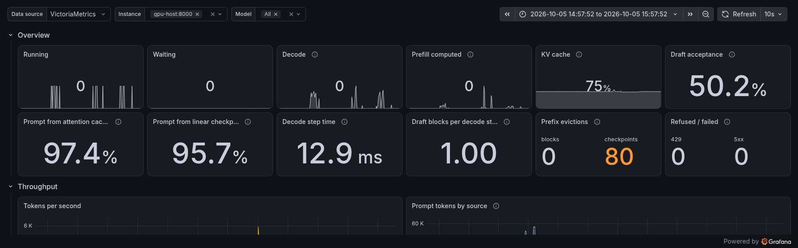

# Grafana dashboard



`radiance.json` is a Grafana dashboard for `/metrics`: throughput, prompt tokens by source, speculative
decoding by draft position, scheduler steps, latency, the prefix cache and HTTP. The whole dashboard:
[dashboard.png](dashboard.png).

Import it (Dashboards → New → Import) and pick a Prometheus data source. Every query is plain PromQL,
so VictoriaMetrics added as a Prometheus data source works the same. Checked with Grafana 13.2 against
Prometheus 3.15 and VictoriaMetrics 1.153 scraping one server.

```yaml
scrape_configs:
  - job_name: radiance
    static_configs:
      - targets: ["gpu-host:8000"]
```

Window values are counter ratios with the definitions of the since-start gauges:

| panel | over the window | since start |
|---|---|---|
| prompt from attention cache | `attn_cached_tokens` / `prompt_tokens` | `vllm:gpu_prefix_cache_hit_rate` |
| prompt from linear checkpoint | `linear_cached_tokens` / (`linear_cached_tokens` + `prefill_tokens`) | `radiance:linear_prefix_cache_hit_rate` |
| draft acceptance | `draft_accepted` / `draft_tokens` | `radiance:draft_acceptance_ratio` |
| conditional acceptance at j | `draft_position_reached`(j+1) / `draft_position_reached`(j) | `radiance:draft_position_acceptance_ratio` |

Position j+1 is evaluated only when j was accepted, so its reach counts j's acceptances. The last
position's acceptances are the total accepted minus every later reach. Draft blocks per decode step is
the reach of position 0 over `engine_steps_decode_total` (GUIDE §6.3).

Prometheus extrapolates `rate()` inside the window and VictoriaMetrics does not, so short windows at
the edge of a burst differ between the two. The overview's ratios are taken over the dashboard's time
range, where both agree.
